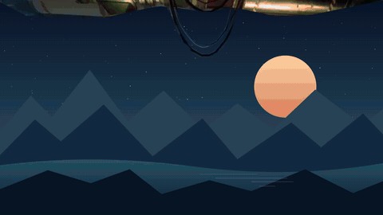
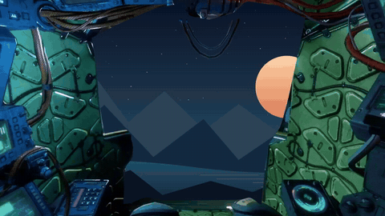

# Titanfall Plymouth

Cockpit panels light up **left → middle → right → top → bottom**, revealing your SDDM picture or wallpaper. Fixed internal seams draw inward, then retract outward. No outer border or logo.

## Demos

| Black | White |
| --- | --- |
|  |  |

[Black with sound](docs/demo/black-audio.mp4) · [White with sound](docs/demo/white-audio.mp4)

Both use the Maldives SDDM greeter at the default **1.25×** speed ([credits](docs/demo/ATTRIBUTION.md)).

**Wallpaper with cyan lines and 1.25× speed**


[Wallpaper video](docs/demo/wallpaper.mp4) · [Example wallpaper](docs/demo/wallpaper.svg)

| Long: approach + typing + closing | Semi-long: closing |
| --- | --- |
|  |  |

[Long with sound](docs/demo/long-audio.mp4) · [Semi-long with sound](docs/demo/semi-long-audio.mp4)

## Interactive setup

Needs **Python 3, FFmpeg, ImageMagick, and Plymouth's script plugin**.

```bash
git clone https://github.com/IiamV/titanfall-plymouth.git
cd titanfall-plymouth
./install.sh
```

Choose **Short** (light-up), **Semi-long** (closing + light-up), or **Long** (outside approach, typing, closing + light-up). Long uses local `long-new.mp4`; Semi-long uses local `semi-long.mp4`. Source clips stay out of Git.

Use arrow keys and Enter to choose **SDDM**, **Picture**, or **Custom**. SDDM and Picture show the exact image path beside the choice. Picture detects your desktop/WM wallpaper, then checks standard wallpaper folders (marked as a fallback). Custom asks for a path (leave it blank for no picture). Then choose colors and speed: **1.25× default**, **1× slower**, **0.75× slower**, or Custom. The wizard builds a preview and offers installation afterward.

- Test without installation: `./install.sh --preview-only`
- Restore the previous theme: `./install.sh --restore`

Installation requests sudo only at the final step and uses `plymouth-set-default-theme -R`. Existing theme files and the previous selection are backed up locally. Short builds work without the original reference media.

The picture is a snapshot, not live SDDM. Audio is optional in video previews; boot audio is not implemented. See [testing, audio, manual installation, and rollback](docs/DEVELOPMENT.md) for details.
